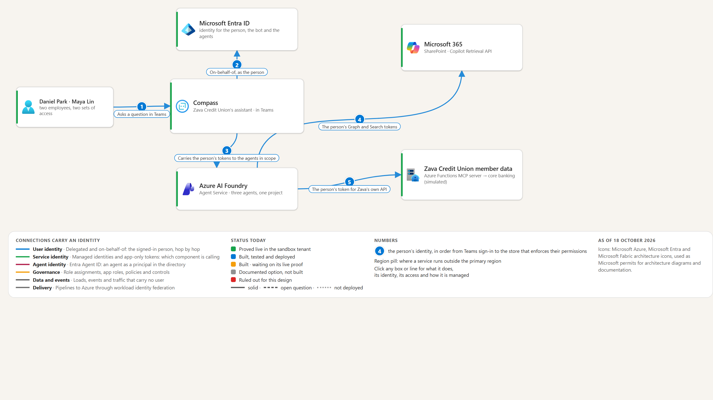

# zava-foundry-obo-reference

A .NET 10 reference build that shows how to keep a **person's own identity** all the way from Microsoft Teams, through Azure AI Foundry agents, to SharePoint and a line-of-business API, using the OAuth 2.0 **on-behalf-of (OBO)** flow. Every downstream call runs as the signed-in person, never as a shared application identity, and the repo contains tests that show it for two people, in both orders.

It uses Foundry hosted and prompt agents, the Microsoft Agent Framework (MAF) workflow, the Microsoft 365 Agents SDK, a Model Context Protocol (MCP) server on Azure Functions, Aspire, `azd` and Bicep.

**Zava Credit Union** is a fictional customer and **Compass** is its fictional Teams assistant. All people, documents and accounts in this repo are invented sample data.

> **Maturity.** This is a reference implementation, not a product. It has been deployed and exercised end to end in one sandbox tenant, redeployed from a clean clone of the public export into a new environment and torn down again (21 Oct 2026; the gaps that run found are fixed in [`docs/DEPLOY.md`](docs/DEPLOY.md), and the Teams upload was not part of it), and everything builds and passes its tests offline. It depends on preview Foundry features and one pre-release package, so expect API changes. It deliberately leaves out production hardening (network isolation, an API gateway, a content-safety policy, SIEM integration); [what is not built](#what-this-is-not) lists them.



## How it works

```text
Teams  ─► Azure Bot Service ─► Compass.Bot.Host ──OBO (MSAL, federated managed-identity credential)──► Microsoft Entra ID
Browser ─► POST /api/briefing (same host, same pipeline, SSE progress)  ┘
                              │  one token per downstream audience the question needs; a MAF workflow runs only those agents, in parallel
                              ▼  x-ms-user-identity + x-client-* headers
                         Foundry agents
   SharePointRetrievalAgent  ──(person's Graph token)──►  Microsoft 365 Copilot Retrieval API
   SharePointAnswerAgent     ──(extracts only, no token)► writes the short cited answer for route A
   SharePointKnowledgeAgent  ──(person's Search token)──► Foundry IQ knowledge base ──► SharePoint (live)
   ZavaApiAgent              ──(x-client-zava-api-token)► Compass.Mcp.ZavaApi.Host (Azure Functions, MCP)
                                                              └─ validates audience and issuer ─► SQLite "core banking"
```

1. The person signs in once (Teams single sign-on, or the web page).
2. The bot resolves who they are and exchanges their token for one token per downstream audience (Graph, Azure AI Search, the sample API) with OBO.
3. A MAF workflow sends the question to only the agents it needs. Each agent receives the person's token for its own audience.
4. SharePoint and the API enforce **their own** permissions for that person. Compass never filters results after the fact.

The full reasoning, hop by hop, is in [`docs/DEMO-SCRIPT.md`](docs/DEMO-SCRIPT.md). Who is who and what each identity may do is in [`docs/IDENTITY-AND-ACCESS.md`](docs/IDENTITY-AND-ACCESS.md).

## Choosing the SharePoint route (and switching it)

The bot can answer SharePoint questions two ways. This is one setting, **`SHAREPOINT_ROUTE`** (app setting `Bot__SharePoint__Route`), and you can change it without redeploying code. The template default is `KnowledgeBase`.

| Value | What runs | Observed speed | Needs |
| --- | --- | --- | --- |
| `KnowledgeBase` | `SharePointKnowledgeAgent` reads SharePoint live through the Foundry IQ knowledge base and writes the answer | about 10 s median (18 Oct, small sample) | Azure AI Search, `infra/scripts/Setup-KnowledgeBase.ps1`, then `--publish-knowledge-agent` |
| `Retrieval` | The hosted `SharePointRetrievalAgent` calls the Copilot Retrieval API with the person's Graph token, then `SharePointAnswerAgent` writes a short cited answer from those extracts | about 5 s median (22 Oct, 12 questions) | The hosted agent published, then `--publish-answer-agent` |
| `Both` | Both branches, shown under separate headings (answers can repeat). For comparing the two | not measured | Everything above |

Both routes read SharePoint through the Copilot Retrieval API, so each person needs a Microsoft 365 Copilot licence either way. The route is a **ceiling**: a question about accounts never starts a SharePoint branch, whatever the route says.

**Switch it now** (no provisioning; the app restarts, which takes about a minute):

```powershell
az webapp config appsettings set -g <resource-group> -n <bot-app> --settings Bot__SharePoint__Route=Retrieval
```

Use exactly `KnowledgeBase`, `Retrieval` or `Both`. A typo makes `GET /health/ready` return 503 and name the setting.

**Switch it for good:** `azd env set SHAREPOINT_ROUTE Retrieval`, then `azd provision`. If you only change the app setting, the next `azd provision` sets it back to whatever the azd environment holds (the default is `KnowledgeBase`).

**Check which route is live:** every briefing ends with a line such as `SharePoint route: Graph retrieval` (or `knowledge base`).

Two more switches apply to `Retrieval`: `Bot__SharePoint__Retrieval__Summarise` (`RETRIEVAL_SUMMARISE`, default `true`; `false` lists the extracts instead of summarising them) and `Bot__SharePoint__Retrieval__MinRelevance` (`RETRIEVAL_MIN_RELEVANCE`, default `0`, which cuts nothing). Details, the privacy note about Application Insights, and the evidence are in [`docs/DEPLOY.md`](docs/DEPLOY.md) and [`docs/SHAREPOINT-ROUTES.md`](docs/SHAREPOINT-ROUTES.md).
## Quick start

### A. Offline: build and test (about 5 minutes, no Azure account)

You need the **.NET 10 SDK**.

```powershell
git clone https://github.com/<owner>/zava-foundry-obo-reference.git
cd zava-foundry-obo-reference
dotnet build Compass.slnx
dotnet test Compass.slnx
```

Expected: 0 build errors and all tests pass; three `Live_*` tests report as skipped because they need a real tenant. **Observed on a clean clone (21 Oct 2026):** 419 tests, 416 passed, 3 skipped. This runs the whole identity flow, including the two-person isolation cases, against fakes. To run the bot and the MCP server on your machine under Aspire, see [`docs/LOCAL-DEVELOPMENT.md`](docs/LOCAL-DEVELOPMENT.md).

### B. Deploy to your own Azure and Microsoft 365 tenant

Allow a few hours the first time, and a **Global Administrator** (or Privileged Role Administrator) for the one admin-consent step.

1. Check your machine and tenant: `pwsh infra/scripts/Test-Prerequisites.ps1 -Mode Deploy` (read-only).
2. Follow [`docs/DEPLOY.md`](docs/DEPLOY.md). It lists the prerequisites, who needs which role, quota, what is automated and what is not, ten numbered steps with the exact commands and how to verify each, and cleanup.
3. If something fails, look it up in [`docs/TROUBLESHOOTING.md`](docs/TROUBLESHOOTING.md).

What the deployment creates: a Foundry account, project and model deployment, Azure AI Search, an App Service for the bot, a Functions app for the MCP server, Application Insights, Key Vault, an Azure Bot, a user-assigned managed identity, custom and built-in role assignments, and the Microsoft Entra app registrations for the bot and the MCP API. The Entra app registrations and the admin consent are PowerShell scripts, not Bicep. The demo people and SharePoint sample documents come from scripts as well.

**Cost.** The deployment uses billable SKUs (see the SKU list in [`docs/DEPLOY.md`](docs/DEPLOY.md)). Tear it down when you are done.

## Repository map

| Path | What is there |
| --- | --- |
| `src/Bot/` | `Compass.Bot.{Domain,Application,Infrastructure,Orchestration,Host}`: person resolution, the per-turn scope, one OBO exchange per audience, the MAF workflow, the Teams and web front doors |
| `src/Agents/` | `Compass.Agents.Contracts`, `.Hosting`, `.Hosted.SharePointRetrieval`, `.Hosted.ZavaApi`, `.Prompt.SharePointKnowledge`, `.Prompt.LearnDocs`: one class per agent; `Hosting` maps the container endpoints |
| `src/Mcp/` | `Compass.Mcp.ZavaApi.{Domain,Application,Infrastructure,Host}`: the Azure Functions MCP server, EF Core and SQLite, JWT audience and issuer middleware |
| `src/Shared/` | `Compass.Shared.{Identity,Messaging,Observability}`: token validation and header names, a small mediator, JWT redaction |
| `apphost/` | Aspire AppHost and service defaults (local orchestration; does not run the Foundry agents) |
| `tools/` | `Compass.Tools.PublishAgents` (publishes agent versions through the Foundry data plane) and `Call-LocalAgent.ps1` |
| `infra/` | Bicep modules, `azure.yaml` for `azd`, PowerShell scripts for Entra, consent, knowledge base and sample data ([`infra/README.md`](infra/README.md)) |
| `teams/` | The Teams app manifest and the package build script |
| `samples/` | A single-file sample of the Learn docs prompt agent |
| `tests/` | Six xUnit projects; see [`docs/LOCAL-DEVELOPMENT.md`](docs/LOCAL-DEVELOPMENT.md) |
| `docs/` | Everything below |

## Documentation map

| Read this | When you want to |
| --- | --- |
| [`docs/DEPLOY.md`](docs/DEPLOY.md) | Stand the whole thing up in your tenant |
| [`docs/IDENTITY-AND-ACCESS.md`](docs/IDENTITY-AND-ACCESS.md) | See every identity, app registration, permission and role, and who must grant what |
| [`docs/TROUBLESHOOTING.md`](docs/TROUBLESHOOTING.md) | Fix a specific error |
| [`docs/LOCAL-DEVELOPMENT.md`](docs/LOCAL-DEVELOPMENT.md) | Build, test and run without Azure |
| [`docs/DEMO-SCRIPT.md`](docs/DEMO-SCRIPT.md) | Understand the story and the identity chain, hop by hop |
| [`docs/SERVICE-CATALOG.md`](docs/SERVICE-CATALOG.md) | See each service, its settings, its identity and its known gaps |
| [`docs/DECISIONS-AND-LESSONS.md`](docs/DECISIONS-AND-LESSONS.md) | Know why a choice was made and what failed first |
| [`docs/LIVE-FINDINGS.md`](docs/LIVE-FINDINGS.md) | See the evidence: what the live run proved and broke, each tagged observed, documented or open |
| [`docs/SHAREPOINT-ROUTES.md`](docs/SHAREPOINT-ROUTES.md) | Choose a SharePoint retrieval option and see why the Retrieval API was used |
| [`docs/OBSERVABILITY.md`](docs/OBSERVABILITY.md) | See what is instrumented, how token redaction is checked, and the optional Agent 365 export |
| [`docs/IMPLEMENTATION-NOTES.md`](docs/IMPLEMENTATION-NOTES.md) | See where the build differs from the dev spec |
| [`docs/Zava-Compass-OBO-Teams-to-SharePoint.md`](docs/Zava-Compass-OBO-Teams-to-SharePoint.md) | Read the research brief and its Microsoft Learn citations |
| [`docs/Zava-Compass-OBO-DevSpec.md`](docs/Zava-Compass-OBO-DevSpec.md) | See the original development spec (a historical build plan) |
| [`docs/diagrams/`](docs/diagrams/Zava-Compass-OBO-Architecture.html) | Open the architecture ([C4](docs/diagrams/Zava-Compass-OBO-Architecture.html)) and [sequence](docs/diagrams/Zava-Compass-OBO-Sequence.html) diagrams |
| [`docs/THIRD-PARTY.md`](docs/THIRD-PARTY.md) | See third-party material and licences |

An index of the same documents is in [`docs/README.md`](docs/README.md).

## Status and evidence

Claims in the docs carry a tag: **observed** (run and seen in this build), **documented** (from Microsoft Learn or a package's documentation, not run here) or **open** (not known).

- **Observed live (sandbox tenant):** the infrastructure provisions; each person sees only their own accounts and only the SharePoint documents they may read, in both directions, through the web page and in a Teams one-to-one chat; knowledge-base answers return real, linked sources; the hosted agents run on the Foundry Responses protocol; Application Insights receives traces from the workflow. On 22 Oct, route A (Graph retrieval) with the answer agent handled 12 questions as Daniel and Maya correctly (6 answered, 6 "No document ..."), with no text crossing between them.
- **Observed offline:** 525 tests across six projects (522 pass, 3 live variants skip), including the two-person isolation cases against fakes.
- **Open:** a real claims step-up demand; the live isolation test variants (they exist and are skipped by default); the Teams upload by an administrator; running the Foundry agents from the Aspire AppHost or Visual Studio F5; Foundry tracing recording the answer agent's extracts, questions and answers in Application Insights (no per-agent switch found); the route A relevance gate ships off because the measured scores overlap; route `Both` can repeat a fact. [`docs/DEPLOY.md`](docs/DEPLOY.md) lists everything that was not exercised.
- **Known warnings:** the Aspire AppHost pulls a transitive MessagePack 2.5.302 with a moderate advisory (GHSA-qhrr-8q5h-9q3h; it is the only vulnerable package reported, and it is local-orchestration only); z bicep build exits 0 but warns that the preview Foundry resource types have no type definitions (BCP081, BCP036, BCP318).
- **Preview dependencies:** the Foundry hosted-agent runtime, Foundry IQ knowledge bases and `Azure.AI.AgentServer.Responses` (1.0.0-beta). Versions are in the project files.

## What this is not

It is a pattern reference and a working example. It does not include network isolation (private endpoints), an API gateway, a content-safety or Responsible AI policy, SIEM integration, high availability, or load testing. The "core banking" data is a SQLite file of invented records. The hosted agents are demonstrated on the Responses protocol; the Invocations protocol is not used.

## Contributing, security, licence

- [`CONTRIBUTING.md`](CONTRIBUTING.md) and [`CODE_OF_CONDUCT.md`](CODE_OF_CONDUCT.md)
- [`SECURITY.md`](SECURITY.md): report vulnerabilities privately, not in a public issue
- [`LICENSE`](LICENSE): MIT. This is sample code provided as is, with no warranty and no support commitment.
