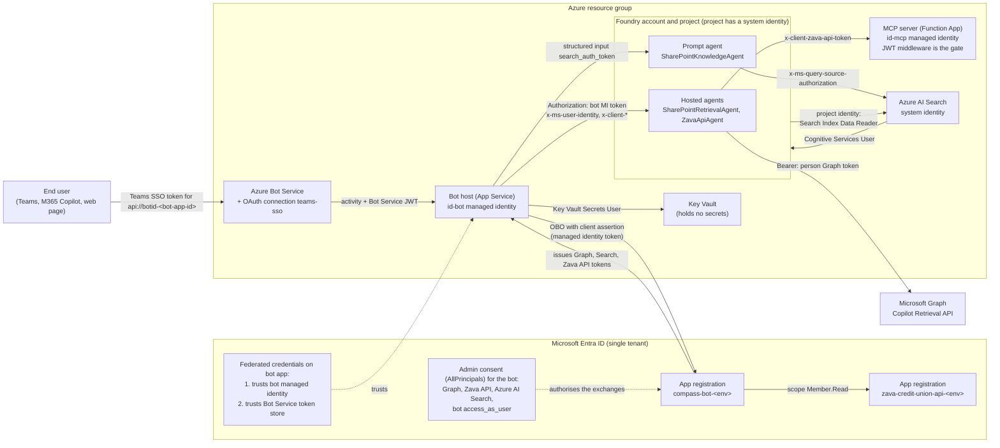

# Identity and access reference

This is the single reference for who is who in Compass, what each identity may do, and what a person needs to stand the
repo up in their own tenant. Every statement was derived from the code on this branch (file and line in brackets) and
checked against Microsoft Learn where a role or permission is named. Line numbers refer to the working tree at the time of
writing and will drift; search for the quoted name if a line has moved. A statement that could not be verified is tagged
`not verified`; one that follows from the code or from Learn but is not stated in either is tagged `inferred`.

Placeholders: `<tenant-id>`, `<env>` (`dev` or `test`), `<suffix>` (six characters derived from the resource group id),
`<bot-app-id>`, `<zava-api-app-id>`, `<bot-mi-principal-id>`, `<project>`, `<account>`.

## Contents

1. [Overview and trust diagram](#1-overview-and-trust-diagram)
2. [Principals](#2-principals)
3. [App registration reference](#3-app-registration-reference)
4. [Consent matrix](#4-consent-matrix)
5. [Token map](#5-token-map)
6. [RBAC table](#6-rbac-table)
7. [Who needs what to deploy](#7-who-needs-what-to-deploy)
8. [What end users need](#8-what-end-users-need)
9. [What this build does not do](#9-what-this-build-does-not-do)
10. [Evidence and caveats](#10-evidence-and-caveats)

---

## 1. Overview and trust diagram

A person signs in to Teams (or to the bot's web page). The bot validates that sign-in token, then exchanges it
on-behalf-of (OBO) for one token per downstream service, using a confidential client whose only credential is a federated
identity credential that trusts the bot's managed identity. No client secret exists anywhere in the repo. The bot calls
Foundry as itself (its managed identity) and names the person in `x-ms-user-identity`; each downstream token travels in its
own header or input. The Zava API MCP server accepts a request only if the token's audience and issuer match its own app
registration. End users hold no Azure role; every Azure role belongs to a service identity.

---

## 2. Principals

| Principal | Kind | What it is for | Created in |
| --- | --- | --- | --- |
| `compass-bot-<env>` | Entra app registration and service principal, single tenant | Azure Bot `msaAppId`; the API that Teams SSO tokens are issued for (`api://botid-<bot-app-id>`); the confidential client for the OBO exchanges; a public (SPA) client for the web page | `infra/scripts/Setup-EntraApps.ps1:300-358`; name at `infra/scripts/Compass.Infra.Common.ps1:39` |
| `zava-credit-union-api-<env>` | Entra app registration and service principal, single tenant | The audience of the Zava API token. Nothing authenticates as it; it only gives the MCP server an audience to check | `Setup-EntraApps.ps1:288-296`; name at `Compass.Infra.Common.ps1:40` |
| Bot user-assigned managed identity `id-bot-compass-<env>-<suffix>` (with the default workload name `compass`) | Azure managed identity | The subject of the bot app's federated credential (client assertion for OBO and for the Agents SDK connection); the identity `DefaultAzureCredential` picks (`AZURE_CLIENT_ID`) to call Foundry; holder of the Foundry and Key Vault roles in section 6 | `infra/modules/appService.bicep:48-52` (name at `infra/main.bicep:138`); attached at `appService.bicep:102-107`; `AZURE_CLIENT_ID` at `appService.bicep:74` |
| MCP user-assigned managed identity `id-mcp-compass-<env>-<suffix>` | Azure managed identity | Function host storage and the Flex deployment container (shared-key access is disabled). It plays no part in validating or issuing person tokens | `infra/modules/functionApp.bicep:78-82`; attached at `functionApp.bicep:169-174` |
| Foundry project identity | System-assigned managed identity on `Microsoft.CognitiveServices/accounts/projects` | Authenticates the project's MCP connection to the Search knowledge base (`authType ProjectManagedIdentity`); publishes tracing to Application Insights | `infra/modules/foundryProject.bicep:86-88`; connection at `infra/scripts/Setup-KnowledgeBase.ps1:193-203` |
| Foundry account identity | System-assigned managed identity on the `AIServices` account | No role assignment or connection in this repo references it | `foundryProject.bicep:69-71` |
| AI Search service identity | System-assigned managed identity | Calls the model in the Foundry account when the knowledge base uses one | `infra/modules/aiSearch.bicep:41-43` |
| Hosted-agent runtime identity | Platform-assigned by Foundry, not defined in this repo | Not used by the code: neither hosted agent builds an Azure credential (`src/Agents/Compass.Agents.Hosted.*/Program.cs`); they use only the tokens the bot forwards. Learn states a hosted agent runs as a platform-assigned managed identity ([Deploy a hosted agent](https://learn.microsoft.com/en-us/azure/foundry/agents/how-to/deploy-hosted-agent-code)). What roles it holds in a live project: `not verified` | Foundry platform |
| Bot Service token store | Microsoft first-party app | Reads the person's Teams SSO token for the bot through the `teams-sso` OAuth connection, authenticating to the bot app through a projected-identity federated credential | Connection: `infra/modules/botOAuthConnection.bicep:37-65`; credential: `Setup-EntraApps.ps1:366-368` |
| Azure Bot resource | Azure resource, no identity of its own | Channel adapter. `msaAppType SingleTenant`, `disableLocalAuth true` | `infra/modules/botService.bicep:30-46` |

---

## 3. App registration reference

Both apps are looked up by display name and created or updated idempotently; two apps with the same name make the script
stop (`Setup-EntraApps.ps1:143-148`). Both are `signInAudience = AzureADMyOrg` with access token version 2 (`:166-167`,
`:211`, `:348`). The script runs twice in azd (`infra/azure.yaml:28-63`): `preprovision` creates the apps and the Teams SSO
credential; `postprovision` re-runs it with the managed identity ids so the second credential and the Teams manifest
fragment can be written. The script needs a signed-in Graph session with `Application.ReadWrite.All` (`:283`).

### 3.1 `zava-credit-union-api-<env>`

| Item | Value | Source |
| --- | --- | --- |
| Identifier URI | `api://zava-credit-union-api-<zava-api-app-id>` | `Setup-EntraApps.ps1:292` |
| Exposed scope | `Member.Read`, type `User`, enabled. Admin text: "Read the signed-in member profile, accounts and transactions on behalf of the user." | `:293-295`, `:197-204` |
| Requested API permissions | None. The script sets no `requiredResourceAccess` on this app | `:288-296` |
| Pre-authorised clients | None | same |
| Redirect URIs / platforms | None | same |
| Federated credentials | None | same |
| Client secret | None | see 3.3 |
| Token audience the MCP server accepts | `api://zava-credit-union-api-<zava-api-app-id>` and `<zava-api-app-id>` (a v2 token carries the app id as `aud`), plus any `additionalZavaApiAudiences` | `infra/main.bicep:163-169`, `:45` |

`Sync-ExposedScope` writes the identifier URI as the only entry in `identifierUris` and keeps existing scopes
(`Setup-EntraApps.ps1:185-216`).

### 3.2 `compass-bot-<env>`

| Item | Value | Source |
| --- | --- | --- |
| Identifier URI | `api://botid-<bot-app-id>` | `Setup-EntraApps.ps1:304` |
| Exposed scope | `access_as_user`, type `User`, enabled. Admin text: "Teams can call the Compass bot on behalf of the signed-in user (SSO)." | `:305-307` |
| Platform `web` redirect URI | `https://token.botframework.com/.auth/web/redirect` (the list is replaced on every run) | `:113`, `:353` |
| Platform `spa` (single-page application) | See the redirect rules below | `:341-344`, `:354` |
| Service principal | Created if missing | `:358` |
| Tenant | Single tenant (`AzureADMyOrg`) | `:166` |

**Requested delegated API permissions** (`requiredResourceAccess`, replaced on every run, `:309-329`):

| Resource | Permission | How the id is found |
| --- | --- | --- |
| Microsoft Graph (`00000003-0000-0000-c000-000000000000`) | `Files.Read.All`, `Sites.Read.All` | Read from the tenant's Graph service principal at run time; the script throws if a name is missing (`Compass.Infra.Common.ps1:153-181`) |
| Zava API (`<zava-api-app-id>`) | `Member.Read` | The scope id written in step 3.1 |
| Azure AI Search (`880da380-985e-4198-81b9-e05b1cc53158`) | `user_impersonation` | Read from the tenant's Search service principal; the script creates that first-party service principal if it does not exist (`Compass.Infra.Common.ps1:183-221`) |

The bot's own `access_as_user` is not in `requiredResourceAccess`; it is covered by an admin-consent grant (section 4).

**Pre-authorised clients.** All seven are pre-authorised for `access_as_user` only (`Setup-EntraApps.ps1:105-112`, `:333-336`).
Pre-authorisation lets these Microsoft clients obtain a token for the bot's scope without a consent prompt, which is what Teams
SSO needs. The first two are the Teams clients; the other five let the same sign-in work from Microsoft 365 and Outlook (script
comment at `:107`). The names below follow [Learn](https://learn.microsoft.com/en-us/microsoftteams/platform/tabs/how-to/authentication/tab-sso-register-aad).

| Client | Client id |
| --- | --- |
| Teams desktop, mobile | `1fec8e78-bce4-4aaf-ab1b-5451cc387264` |
| Teams web | `5e3ce6c0-2b1f-4285-8d4b-75ee78787346` |
| Microsoft 365 web | `4765445b-32c6-49b0-83e6-1d93765276ca` |
| Microsoft 365 desktop | `0ec893e0-5785-4de6-99da-4ed124e5296c` |
| Microsoft 365 mobile (Learn: "Microsoft 365 mobile / Outlook desktop") | `d3590ed6-52b3-4102-aeff-aad2292ab01c` |
| Outlook web | `bc59ab01-8403-45c6-8796-ac3ef710b3e3` |
| Outlook mobile | `27922004-5251-4030-b22d-91ecd9a37ea4` |

**SPA platform and redirect-URI rules** (the web page is a public client of this same registration: auth code with PKCE, no
secret; the page uses `window.location.origin + '/'` as its redirect URI, `src/Bot/Compass.Bot.Host/wwwroot/app.js:51`):

- Existing SPA redirect URIs are read back and kept; new ones are added, then the set is de-duplicated (`Setup-EntraApps.ps1:341-344`). The script never removes one, so a stale URI has to be removed by hand.
- `http://localhost:<port>/` is added for each port passed in `-LocalPort`. The default is none (`:96`).
- azd passes `-LocalPort 5240` only when the azd environment name is `dev`, in both hooks (`infra/azure.yaml:37`, `:59`). `5240` is the http port in `src/Bot/Compass.Bot.Host/Properties/launchSettings.json`. A `test` environment therefore never registers a localhost redirect.
- `<bot origin>/` is added when `-BotEndpoint` is passed. azd passes `SERVICE_BOT_ENDPOINT` when it is set (`azure.yaml:35`, `:58`). It does not exist during the first `preprovision`, so the origin is registered from `postprovision` onward.
- The `web`, `requiredResourceAccess` and `preAuthorizedApplications` values are replaced, not merged, on each run (`Setup-EntraApps.ps1:347-354`). Edits made by hand to those three are lost on the next run; SPA redirect URIs are the exception.

**Federated identity credentials** (`Sync-FederatedCredential`, `:237-282`). Both use audience `api://AzureADTokenExchange`
(hard-coded, `:248`; this is the value for the global Entra cloud per [Learn](https://learn.microsoft.com/en-us/entra/workload-id/workload-identity-federation-config-app-trust-managed-identity)).
A credential with the same name is updated in place when issuer, subject or audience differ.

| Credential name | Issuer | Subject | Audience | Created |
| --- | --- | --- | --- | --- |
| `compass-bot-mi-<env>` | `https://login.microsoftonline.com/<tenant-id>/v2.0` | `<bot-mi-principal-id>` (the managed identity's principal/object id) | `api://AzureADTokenExchange` | Second pass only. Skipped with a warning when `-ManagedIdentityPrincipalId` is not given (`:372-381`) because the identity does not exist before the first provision |
| `compass-bot-teams-sso-<env>` | `https://login.microsoftonline.com/<tenant-id>/v2.0` | `/eid1/c/pub/t/<base64url of the tenant GUID bytes>/a/9ExAW52n_ky4ZiS_jhpJIQ/compass-teams-sso-<env>` | `api://AzureADTokenExchange` | First pass (does not depend on the managed identity) (`:365-368`) |

The last segment of the Teams SSO subject must equal the OAuth connection's `UniqueIdentifier`: both default to
`compass-teams-sso-<env>` (`Compass.Infra.Common.ps1:43`, `infra/main.bicep` parameter `teamsSsoUniqueId`, `botOAuthConnection.bicep:50-54`).
`9ExAW52n_ky4ZiS_jhpJIQ` is the encoded id of the Bot Service Token Store per
[Learn](https://learn.microsoft.com/en-us/microsoft-365/agents-sdk/azure-bot-user-authorization-federated-credentials).
The same page states the OAuth connection supports a single tenant only and that for Teams SSO the token exchange URL is
`api://botid-{appId}`; the Bicep sets exactly that (`main.bicep:283`).

### 3.3 Client secrets: none

A search of `*.cs`, `*.ps1`, `*.bicep`, `*.json`, `*.yaml`, `*.csproj`, and the front-door `app.js` and `index.html` (excluding build output and the vendored MSAL library) for `passwordCredentials`,
`Add-MgApplicationPassword`, `New-AzADAppCredential`, `AddPassword`, `keyCredentials`, `ClientSecret`, `client_secret` and
`WithClientSecret` found no creation or use of a secret. The only hit is a test asserting that the web page script does not
contain the text `client_secret` (`tests/Compass.IdentityIsolation.Tests/FrontDoorPageTests.cs:41`). The OBO client is built
with `WithClientAssertion` only (`src/Bot/Compass.Bot.Infrastructure/Obo/MsalOnBehalfOfClient.cs:19-23`). The Agents SDK
connection is `AuthType = FederatedCredentials` (`appService.bicep:80`). The Azure Bot, Search, Foundry and Key Vault settings
that would otherwise hold keys are off or unused: `disableLocalAuth true` on the Bot (`botService.bicep:44`), Search
(`aiSearch.bicep:49`) and Foundry account (`foundryProject.bicep:76`); shared-key access disabled on the Function storage
(`functionApp.bicep:97`). Application Insights keeps `DisableLocalAuth: false` (`infra/modules/appInsights.bicep:42`) and the
apps send telemetry with its connection string (`appService.bicep:72`, `functionApp.bicep:156`); see section 9.

---

## 4. Consent matrix

`infra/scripts/Grant-AdminConsent.ps1` creates delegated permission grants for the bot's service principal (client), all
with `consentType = AllPrincipals` (`:77`, `:87`). Scope names are the values in the grant.

| # | Client | Resource | Scope(s) | Consent type | Source |
| --- | --- | --- | --- | --- | --- |
| 1 | `compass-bot-<env>` | Microsoft Graph | `Files.Read.All`, `Sites.Read.All` | AllPrincipals | `Grant-AdminConsent.ps1:139` |
| 2 | `compass-bot-<env>` | `zava-credit-union-api-<env>` | `Member.Read` | AllPrincipals | `:140` |
| 3 | `compass-bot-<env>` | `compass-bot-<env>` itself | `access_as_user` | AllPrincipals. The web page is a public client of the same registration; consenting for everyone avoids a prompt there. Teams is pre-authorised instead | `:143` |
| 4 | `compass-bot-<env>` | Azure AI Search | `user_impersonation` | AllPrincipals. Created only if the Search service principal can be found or created | `:145-148` |

- **Who can run it.** The script connects with `DelegatedPermissionGrant.ReadWrite.All` and `Application.Read.All` and throws unless the first is in the session (`:124-129`). On a 403 it tells the caller to use a Global Administrator or Privileged Role Administrator (`:110-111`). Its notes also list Cloud Application Administrator "for non-Graph resources" (`:37-39`). Learn's tenant-wide consent prerequisites ([Grant tenant-wide admin consent](https://learn.microsoft.com/en-us/entra/identity/enterprise-apps/grant-admin-consent)) are Privileged Role Administrator for any permission on any API, and Cloud Application Administrator, AI Administrator or Application Administrator for any API except Microsoft Graph application permissions (app roles). All four grants above are delegated, so the Learn text suggests Cloud Application Administrator or Application Administrator would also be enough for grant 1; `inferred`, not tested.
- **If the grant already exists.** Lookup is by client, resource and `AllPrincipals` (`:77-78`). Missing scopes are appended to the existing grant (`Update-MgOauth2PermissionGrant`); scopes granted by other means are kept; if nothing is missing the grant is left alone. The result per grant is `created`, `updated` or `unchanged` (`:82-106`). The script never removes a scope.
- **When azd runs it.** Only in `postprovision`, and only when the azd environment value `RUN_ADMIN_CONSENT` is exactly `true` (`infra/azure.yaml:61-63`). It never runs in `preprovision`. Otherwise run it by hand once per tenant and environment, after `Setup-EntraApps.ps1`.
- It needs the two service principals to exist and fails with a pointer to `Setup-EntraApps.ps1` if not (`:56-66`).

---

## 5. Token map

**Which audiences a turn acquires.** The route is chosen once at startup (`Bot:SharePoint:Route`, default `KnowledgeBase`;
`infra/main.bicep` parameter `sharePointRoute`). `KnowledgeBase` acquires Search and Zava API tokens, `Retrieval` acquires
Graph and Zava API, `Both` acquires all three (`src/Bot/Compass.Bot.Application/Models/BriefingRoutePolicy.cs:79-84`). Each
turn is narrowed further by the question's focus, which can only remove branches: a policy-only question needs no Zava API
token and no member number; an accounts-only question needs no SharePoint token (`BriefingRoutePolicy.cs:41-44`,
`GetMemberBriefingQueryHandler.cs:34-45`).

| Token | What it is for | Acquired where and how | Carried by | Validated by |
| --- | --- | --- | --- | --- |
| **Person's sign-in token for the bot's own API** (`aud` = `<bot-app-id>` for a v2 token; the app id URI `api://botid-<bot-app-id>` is also accepted) | Proves who the person is; it is the user assertion for every OBO exchange | Teams: Azure Bot Service token store through OAuth connection `teams-sso` (scope `api://botid-<bot-app-id>/access_as_user`, `main.bicep:276-286`); the bot reads it with `UserAuthorization.GetTurnTokenAsync` (`src/Bot/Compass.Bot.Host/CompassAgent.cs:30`). Web page: MSAL.js with scope `api://botid-<bot-app-id>/access_as_user` (`FrontDoor/FrontDoorConfig.cs:28`), sent as `Authorization: Bearer` to `POST /api/briefing` | In process only; never forwarded | `TeamsSsoPersonContextResolver` calls `JwtAccessTokenValidator` with the `Bot:Auth` settings: audiences `api://botid-<bot-app-id>` and `<bot-app-id>`, issuer `https://login.microsoftonline.com/<tenant-id>/v2.0`, RS256 signature from the authority's OIDC keys, lifetime, 1 minute clock skew. It then requires `oid` and `tid` claims (`Compass.Bot.Infrastructure/Identity/TeamsSsoPersonContextResolver.cs:18-31`; settings `main.bicep:244-247`) |
| **Microsoft Graph** (`https://graph.microsoft.com/.default`) | Person-scoped call to the Copilot Retrieval API (`POST v1.0/copilot/retrieval`, data source `sharePoint`); routes `Retrieval`, `Both` | OBO by `OboTokenBroker` using `MsalOnBehalfOfClient`: a fresh `ConfidentialClientApplication` per exchange, `AcquireTokenOnBehalfOf`, client assertion from `ManagedIdentityClientAssertionProvider` (a token of the bot's user-assigned managed identity for `api://AzureADTokenExchange/.default`). Default scope list in `OnBehalfOfOptions.cs:25` | HTTP header `x-client-graph-access-token`, raw token with no `Bearer`, bot → Foundry → `SharePointRetrievalAgent` (`CompassHeaders.cs:11`, `FoundryHostedAgentGateway.cs:63-66`). The agent then calls Graph with `Authorization: Bearer` (`GraphRetrievalClient.cs:29`) | Microsoft Graph (not repo code). The agent throws if the header is missing and does not fall back to an app identity (`SharePointRetrievalAgent.cs:22`) |
| **Azure AI Search** (`https://search.azure.com/.default`; `Bot:Obo:SearchScopes`, `main.bicep:249`) | Lets the knowledge base's remote SharePoint source query as the person; routes `KnowledgeBase`, `Both` | Same OBO path | Not an HTTP header. The bot process itself calls the Foundry Responses API for the prompt agent and sets the Foundry structured input `search_auth_token` (`SharePointKnowledgeAgent.cs:38`). The agent definition binds the placeholder `{{search_auth_token}}` to the MCP tool header `x-ms-query-source-authorization` (`SharePointKnowledgeAgentDefinition.cs:49`). The name `x-client-search-token` (`CompassHeaders.cs:20`) is only the key used inside the bot | Azure AI Search and its remote SharePoint source (not repo code). The agent throws before any Foundry call if the token is missing (`SharePointKnowledgeAgent.cs:32`) |
| **Zava API** (`api://zava-credit-union-api-<zava-api-app-id>/.default`; `main.bicep:248`) | Person-scoped call to the member API | Same OBO path | HTTP header `x-client-zava-api-token`, raw token, bot → Foundry → `ZavaApiAgent` → the same header on the MCP request to the Function App's `/runtime/webhooks/mcp` (`ZavaApiMcpClient.cs:33`). The agent forwards it unchanged | `ZavaApiTokenValidationMiddleware` on every tool call, using `JwtAccessTokenValidator` with `ZavaApi:Auth`: audiences from section 3.1, issuer `https://login.microsoftonline.com/<tenant-id>/v2.0` (`infra/main.bicep:152`, `functionApp.bicep:140-152`), RS256, lifetime, 1 minute skew. Missing or invalid token stops the call before the tool runs (`ZavaApiTokenValidationMiddleware.cs:25-41`) |
| **Bot identity token for Foundry** (not a person token) | Authenticates the bot as the caller of the agent endpoints | `DefaultAzureCredential` registered in `Compass.Bot.Infrastructure/DependencyInjection.cs:40`; it picks the bot managed identity because `AZURE_CLIENT_ID` is set. The token's audience is chosen by the Foundry SDK (`not verified` in this repo) | `Authorization` header on the SDK call, plus `x-ms-user-identity: <person oid>` and `x-compass-session-id` (hosted agents only; `FoundryHostedAgentGateway.cs:58-62`) | Foundry. A caller without the `UserIdentityImpersonation` data action cannot send `x-ms-user-identity` (Learn: 403) |
| **Bot connector token** (`https://api.botframework.com/.default`) | The bot replying through Azure Bot Service | Agents SDK `ServiceConnection`, `AuthType FederatedCredentials`, `ClientId` = `<bot-app-id>`, `FederatedClientId` = the managed identity's client id (`appService.bicep:80-86`) | Outbound to Bot Service | Bot Service |
| **Bot Service channel token** (inbound) | Protects `/api/messages` | Issued by Azure Bot Service | `Authorization` on the inbound activity | `BotChannelAuthentication`: audience `<bot-app-id>`, issuer default `https://api.botframework.com`, keys from `https://login.botframework.com/v1/.well-known/openidconfiguration` (`Bot.Host/BotChannelAuthentication.cs:18-37`; audience set at `main.bicep:242`). This is separate from the person's token |

**Inside the hosted agent.** The Foundry hosting adapter drops `Authorization` and forwards `x-client-*` headers. The agent
keeps only headers that start with `x-client-` as tokens and takes the person from the platform-injected user id, falling back
to `x-agent-user-id` then `x-ms-user-identity` for local runs without the platform
(`src/Agents/Compass.Agents.Hosting/AgentCallContextFactory.cs:18-48`). The "adapter drops `Authorization`" statement comes from
that class's comments and the architecture model, not from a test in this repo (`not verified`).

**What the model sees.** The two hosted agent classes (`SharePointRetrievalAgent`, `ZavaApiAgent`) are plain code and make no
model call (`inferred` from reading both classes and their `Program.cs`). For the prompt agent, the Responses input item is
only the person's question (`SharePointKnowledgeAgent.cs:37`); the token is set as a structured input and used for a header
binding. Whether Foundry exposes structured-input values to the model: `not verified`.

---

## 6. RBAC table

These are all the role assignments and role definitions in the Bicep (confirmed by searching `infra/` for
`roleAssignments@` and `roleDefinitions@`). No end user and no person appears in any of them.

| # | Principal | Role | Scope | Why | Source |
| --- | --- | --- | --- | --- | --- |
| 1 | Bot managed identity | **Compass Agent Impersonator (`<env>`)** (custom, defined below) | Each hosted agent's application resource: `<account>/projects/<project>/applications/<agent>` for `SharePointRetrievalAgent` and `ZavaApiAgent`. Only when `perAgentScope` is true | Lets the bot send `x-ms-user-identity` so each person gets an isolated agent session | `infra/modules/rbac.bicep:101-109` |
| 2 | Bot managed identity | **Foundry User** (`53ca6127-db72-4b80-b1b0-d745d6d5456d`, parameter `agentConsumerRoleDefinitionId`) | Same per-agent scope, same condition | Invoke the hosted agents | `rbac.bicep:111-119` |
| 3 | Bot managed identity | **Foundry User** | The prompt agent's application resource (`SharePointKnowledgeAgent`). Only when `perAgentScope` is true | Invoke the prompt agent. It gets no impersonation role because the person reaches the knowledge base through their Search token, not an `x-ms-user-identity` assertion (comment at `rbac.bicep:121-122`) | `rbac.bicep:123-131` |
| 4 | Bot managed identity | **Compass Agent Impersonator (`<env>`)** | Foundry project `<account>/projects/<project>`. Only when `perAgentScope` is false | As row 1 | `rbac.bicep:133-141` |
| 5 | Bot managed identity | **Foundry User** | Foundry project. Only when `perAgentScope` is false | As rows 2 and 3 | `rbac.bicep:143-151` |
| 6 | Foundry project identity | **Search Index Data Reader** (`1407120a-92aa-4202-b7e9-c0e197c71c8f`) | The Search service. Only when the knowledge base is deployed (`deployKnowledgeBase`, default true) | The project's MCP connection reaches the knowledge base as the project identity; the person's own token still trims results | `rbac.bicep:159-167` |
| 7 | Search service identity | **Cognitive Services User** (`a97b65f3-24c7-4388-baec-2e87135dc908`) | The Foundry account | The knowledge base can use a model in the account. The comment says it is needed only when the knowledge base is configured with a model; the assignment is made whenever the knowledge base is deployed | `rbac.bicep:170-178` |
| 8 | Bot managed identity | **Key Vault Secrets User** (`4633458b-17de-408a-b874-0445c86b69e6`) | The Key Vault (RBAC authorisation on) | Read secrets. The vault holds none (`keyVault.bicep:1-2`); `KeyVault__Uri` is set (`appService.bicep:76`) but no C# file under `src/` mentions Key Vault, so no code reads it (searched `src/**/*.cs`) | `rbac.bicep:180-188`, `keyVault.bicep:36` |
| 9 | MCP managed identity | **Storage Blob Data Owner** (`b7e6dc6d-f1e8-4753-8033-0f276bb0955b`), **Storage Queue Data Contributor** (`974c5e8b-45b9-4653-ba55-5f855dd0fb88`), **Storage Table Data Contributor** (`0a9a7e1f-b9d0-4cc4-a60d-0319b160aaa3`) | The Function App's storage account | Host storage and the Flex deployment container with shared keys disabled. Kept in `functionApp.bicep`, not `rbac.bicep`, because the app cannot start without them | `functionApp.bicep:69-76`, `:116-124` |
| 10 | Foundry project identity | **Monitoring Metrics Publisher** (`3913510d-42f4-4e42-8a64-420c390055eb`) | The Application Insights component | Publish Foundry tracing telemetry | `foundryProject.bicep:136-146` |

Role names and ids were checked against Learn: [AI and machine learning roles](https://learn.microsoft.com/en-us/azure/role-based-access-control/built-in-roles/ai-machine-learning)
(Foundry User, Cognitive Services User), [built-in roles](https://learn.microsoft.com/en-us/azure/role-based-access-control/built-in-roles)
(Search Index Data Reader, Key Vault Secrets User, the three Storage roles, Monitoring Metrics Publisher).

**Custom role.** Defined once in Bicep (`rbac.bicep:79-99`) and, as a fallback, by script (`New-FoundryImpersonationRole.ps1:96-131`).

| Field | Value |
| --- | --- |
| Name | `Compass Agent Impersonator (<env>)` (`main.bicep:149`, `Compass.Infra.Common.ps1:44`). One per environment because role names are unique per tenant |
| Type | `CustomRole` |
| Actions, NotActions, NotDataActions | Empty |
| Data actions | `Microsoft.CognitiveServices/accounts/AIServices/agents/endpoints/UserIdentityImpersonation/action` (`rbac.bicep:90`) |
| Assignable scope | The Foundry account (`rbac.bicep:95-97`) |
| Role definition name (GUID) | `guid(<account id>, 'compass-agent-impersonator')` (`rbac.bicep:80`) |

Learn states this data action is not included in any built-in role, that the built-in Foundry User and Foundry Owner roles
no longer grant it through `Microsoft.CognitiveServices/*`, and that it is granted through a custom role like this one
([Hosted agent permissions](https://learn.microsoft.com/en-us/azure/foundry/agents/concepts/hosted-agent-permissions)).
The Bicep comment and `infra/README.md` assume the wildcard in Foundry User does include it, which is why both roles share one scope.
The Learn built-in roles page still lists `Microsoft.CognitiveServices/*` as a Foundry User data action. Either way the
custom role is assigned at the same scope, so the result is the same. Which statement is current for a given tenant: `not verified`.

**Project scope or per-agent scope.** The switch is the Bicep parameter `createAgentApplications` (azd env value
`CREATE_AGENT_APPLICATIONS`). It feeds `createApplications` in `foundryAgents.bicep` (`main.bicep:315`) and `perAgentScope` in
`rbac.bicep` (`main.bicep:331`, `rbac.bicep:38`). In this working tree the default is `false` (`main.bicep:79`;
`main.parameters.json` maps `CREATE_AGENT_APPLICATIONS` with a default of `false`), so the default deployment assigns rows 4
and 5 at the Foundry project and creates no `applications` resources. With `true`, rows 1 to 3 are used at each agent's
application resource. The deployed scope is output as `FOUNDRY_RBAC_SCOPE` = `per-agent-application` or `project`
(`rbac.bicep:191`). The per-agent path depends on the preview resource type
`Microsoft.CognitiveServices/accounts/projects/applications@2026-09-15-preview`; `foundryAgents.bicep:16-23` records that a
live deployment rejected the `authorizationPolicy` shape, so the per-agent path has not been shown to work end to end
(`not verified`). `New-FoundryImpersonationRole.ps1` assigns per agent by default (`<project scope>/applications/<agent>`,
`:178-184`) or at the project with `-AssignAtProjectScope`.

---

## 7. Who needs what to deploy

Entra roles below are directory roles; Graph scopes are delegated scopes the script requests for the signed-in human. No
script uses an application permission. Role names for Azure and Entra were checked on Learn (links in section 10).

| Step | Entra directory role / Graph scope | Azure RBAC role | Basis |
| --- | --- | --- | --- |
| **1. Provision** (`azd provision`: Bicep, plus the two azd hooks) | The hooks run `Setup-EntraApps.ps1`; see step 2 | Creates resources, one custom role definition and role assignments (section 6). **Owner** on the resource group, or **Contributor** plus **User Access Administrator**. Foundry resource creation needs write on `Microsoft.CognitiveServices`; the custom role needs `Microsoft.Authorization/roleDefinitions/write` | `infra/README.md` "Live handoff" step 1 says "Owner/User Access Administrator on the resource group". Learn: **Role Based Access Control Administrator** only has `roleAssignments/write` and `delete`, so Contributor plus that role could not create the custom role (`inferred`) |
| **2. Entra app creation** (`Setup-EntraApps.ps1`, both passes) | Graph scope `Application.ReadWrite.All` (`:283`). Role: the script's notes say "Application Developer or higher" (`:69`). Because the script also creates the first-party Azure AI Search service principal when it is missing, and Learn lists only **Application Administrator** or **Cloud Application Administrator** for creating a service principal for a multitenant app, use one of those two (`inferred`). `infra/README.md` says Application Administrator | None. The script makes no Azure calls (`inferred` from reading it) | Script `Connect-CompassGraph`; [Create servicePrincipal](https://learn.microsoft.com/en-us/graph/api/serviceprincipal-post-serviceprincipals?view=graph-rest-1.0) |
| **3. Admin consent** (`Grant-AdminConsent.ps1`) | Graph scopes `DelegatedPermissionGrant.ReadWrite.All` and `Application.Read.All`. Role: Global Administrator or Privileged Role Administrator per the script; Learn also allows Cloud Application Administrator, AI Administrator or Application Administrator for delegated grants (section 4) | None | `Grant-AdminConsent.ps1:110-129`; [Learn](https://learn.microsoft.com/en-us/entra/identity/enterprise-apps/grant-admin-consent) |
| **4. Publish hosted agents** (`tools/Compass.Tools.PublishAgents`) | None | **Foundry Project Manager** at the Foundry project (`eadc314b-1a2d-4efa-be10-5d325db5065e`). The tool uses `DefaultAzureCredential` | `infra/README.md` "Publishing the hosted agents"; Learn [Deploy a hosted agent](https://learn.microsoft.com/en-us/azure/foundry/agents/how-to/deploy-hosted-agent-code); `tools/Compass.Tools.PublishAgents/Program.cs:38` |
| **5. Publish the prompt agent** (`dotnet run --project src/Bot/Compass.Bot.Host -- --publish-knowledge-agent`) | None | The operator's own identity through `DefaultAzureCredential`, not the bot's (`SharePointKnowledgeAgentProvisioner.cs:11-13`). Role not named in code. Learn's hosted-agent table lists Foundry User and Foundry Project Manager as able to create agents; use **Foundry Project Manager** to match step 4 (`inferred`) | `Compass.Bot.Host/Program.cs:56-61` |
| **6. Knowledge base setup** (`Setup-KnowledgeBase.ps1`) | None | **Search Service Contributor** on the Search service and **Contributor** on the Foundry project, per the script's notes (`:57`). Learn: Search Service Contributor can create knowledge bases and other search objects through the data plane. The script gets tokens for `https://search.azure.com` and `https://management.azure.com` from `Az.Accounts` or the Azure CLI. The Foundry portal's Knowledge page also needs **Search Index Data Reader** and **Search Service Contributor** for whoever opens it (`:208-211`) | [Search RBAC](https://learn.microsoft.com/en-us/azure/search/search-security-rbac); [remote SharePoint source](https://learn.microsoft.com/en-us/azure/search/agentic-knowledge-source-how-to-sharepoint-remote) |
| **7. SharePoint site and seed data** (`Seed-SharePointTestData.ps1`; `Assert-DemoUsers.ps1`; `Set-MemberMapping.ps1`) | Seeding: none in Entra, but a **Site Owner** (or Manage Web) on the existing SharePoint site (`Seed-SharePointTestData.ps1:45`) and an Entra app registration allowed for interactive PnP.PowerShell sign-in (`-PnPClientId`). The script does not create the site; who may create it: `not verified`. `Assert-DemoUsers.ps1` and `Set-MemberMapping.ps1`: Graph scope `User.Read.All`, read only | Seeding: none. `Set-MemberMapping.ps1`: a signed-in Azure CLI that can write the bot web app's settings (`:34-35`); **Website Contributor** or **Contributor** on the web app (`inferred`) | Script headers |
| **8. Teams package and publish** (`teams/Build-TeamsPackage.ps1`, then the Teams admin center) | Building the package: none; it reads `infra/.generated/teams-webApplicationInfo.json` and writes a zip. Uploading as an org app: the repo does not name a role; **Teams Administrator** or **Global Administrator** (`inferred`, from `docs/SERVICE-CATALOG.md` and Learn's role list) | None | `Build-TeamsPackage.ps1:40-57`; `infra/README.md` "Live handoff" step 5 |
| **9. Deploy** (`azd deploy`) | None | Deploy rights on the bot web app and the Function App, for example **Contributor** on the resource group (`inferred`). Whether Flex Consumption deployment also needs a Storage data role for the deployer: `not verified` | `infra/azure.yaml:15-23` |
| **Fallback: impersonation role script** (`New-FoundryImpersonationRole.ps1`) | None | **Owner** or **User Access Administrator** on the Foundry account (`.NOTES`), through `Connect-AzAccount` | Script `.NOTES` and `:173-175` |

---

## 8. What end users need

- **Azure role: none.** No role assignment in the Bicep names a person (section 6). The design rule is that a person never receives a Foundry, Search or Key Vault role; the impersonation role is held only by the bot (`rbac.bicep:3-4`). `infra/README.md` makes the same statement for the Search role.
- **Entra.** An account in the tenant. Both app registrations are single tenant. Consent is granted once, tenant-wide, by an administrator (section 4), so the person is not prompted.
- **Microsoft 365 licences.** `Assert-DemoUsers.ps1` requires, for each demo person, an enabled account, a provisioned Teams service plan (`TEAMS1`) and a provisioned Microsoft 365 Copilot service plan (name starting `M365_COPILOT`) (`:65-66`, `:76`, `:88-89`). Its stated reason is that the Copilot Retrieval API is licensed per user (`:12-13`). `Setup-KnowledgeBase.ps1` states the same requirement for the knowledge-base route: "The person querying needs a Microsoft 365 Copilot licence or the pay-as-you-go Retrieval API" and a limit of 200 requests per user per hour for remote SharePoint (`:58-59`). Learn agrees for both routes: the Retrieval API is included for users with a Microsoft 365 Copilot add-on licence and otherwise available by pay-as-you-go for SharePoint ([Retrieval API overview](https://learn.microsoft.com/en-us/microsoft-365/copilot/extensibility/api/ai-services/retrieval/overview); [remote SharePoint source](https://learn.microsoft.com/en-us/azure/search/agentic-knowledge-source-how-to-sharepoint-remote)). The Zava API route reads no Microsoft 365 data and has no licence check in the code.
- **A member link, for the accounts branch only.** The bot maps the person's token `oid` to a member number from configuration (`Bot:Members:ByObjectId`; `ConfiguredMemberNumberResolver.cs:16-25`; written by `Set-MemberMapping.ps1:68`). An unmapped person gets `MemberNotLinkedException`. A policy-only question does not need the mapping (`GetMemberBriefingQueryHandler.cs:36-37`).
- **SharePoint permissions decide what is returned.** The bot sends the person's own Graph or Search token, and the agents never post-filter hits (`SharePointRetrievalAgent.cs:9-17`). The seed script creates three libraries with unique (non-inherited) permissions, one readable by one demo person, one by the other, one by both (`Seed-SharePointTestData.ps1:7-15`). The knowledge source is `remoteSharePoint`: nothing is indexed or copied, and the query runs with the caller's delegated token (`Setup-KnowledgeBase.ps1:11-14`).
- **Teams.** The app must be available to the person in the tenant's Teams admin settings; the repo does not configure this (`not verified`).

---

## 9. What this build does not do

Only items the code supports.

| Difference from a production design | Evidence |
| --- | --- |
| **Project-scope RBAC by default.** The bot identity holds Foundry User and the impersonation role on the whole Foundry project, so it can invoke and impersonate against every agent in it. Per-agent scope exists but is off by default and unproven | `main.bicep:79`, `rbac.bicep:133-151`, `foundryAgents.bicep:16-23` |
| **Public endpoints.** Key Vault, Search and the Foundry account have public network access enabled; the templates define no private endpoints, network ACLs, IP restrictions or virtual network integration for the web app, Function App or storage account | `keyVault.bicep:41`, `aiSearch.bicep:32`, `foundryProject.bicep:38`; no matches for `privateEndpoint`, `ipSecurityRestrictions`, `networkAcls` or `virtualNetwork` in `infra/` |
| **Anonymous Functions webhook; the JWT middleware is the only gate.** The MCP extension's webhook authorisation level is `Anonymous` in both `host.json` and an app setting, so no system key is required. App Service Authentication is not configured | `functionApp.bicep:161`, `src/Mcp/Compass.Mcp.ZavaApi.Host/host.json:7`, `ZavaApiTokenValidationMiddleware.cs:25-41` |
| **The MCP server authorises by token validity, not by person.** It validates audience, issuer, signature and lifetime, and records the `oid` for logging only. It does not check the `scp` claim, and it does not compare the token's person with the `memberNumber` tool argument, which the bot supplies from configuration. Any valid token for the Zava API audience can ask for any member number | `ZavaApiTokenValidationMiddleware.cs:37`, `JwtAccessTokenValidator.cs:28-41`, `Tools/GetMemberSummaryTool.cs:14-17`; no `scp`, `roles` or `oid` checks in `src/Mcp` |
| **The web front door endpoints are anonymous at the framework level**; the bearer is validated inside the briefing query by the same validator Teams uses. The page keeps MSAL tokens in `sessionStorage` | `FrontDoorExtensions.cs:57-60`, `wwwroot/app.js:54` |
| **Application Insights is not keyless.** Local authentication stays enabled and telemetry uses the connection string | `appInsights.bicep:42`, `appService.bicep:72` |
| **Key Vault is deployed but empty,** with purge protection off by default | `keyVault.bicep:1-2`, `main.bicep` parameter `enableKeyVaultPurgeProtection` |
| **App registrations have no owners set by the script,** and no Conditional Access policy is created | No owner call in `Setup-EntraApps.ps1`; `Assert-DemoUsers.ps1:7-9` |
| **Global-cloud values are hard-coded** in the credential audience and the Azure AI Search app id | `Setup-EntraApps.ps1:248`, `Compass.Infra.Common.ps1:21` |
| **Policy opt-out tag.** `sandboxPolicyOptOut` (default `false`) tags every resource with `SecurityControl=Ignore` and `CostControl=Ignore` to skip governance policies. For disposable demo tenants only | `main.bicep:108-109` |
| **Agent 365 telemetry is app-only and unverified live.** With `--agent365` the hosting library exports traces under the hosted agent's own instance identity (service to service). The person's identity never enters telemetry, and identity isolation is unchanged. The instance must be registered with Agent 365, or hold `Agent365.Observability.OtelWrite` with admin consent. Not run against a live tenant | `Agent365Telemetry.cs`, `Agent365ObservabilityTests.cs`; [DECISIONS B6a](DECISIONS-AND-LESSONS.md) |
| **Environments** are limited to `dev` and `test`, and a single tenant | `main.bicep` `@allowed` on `environmentName`; `ValidateSet` in the scripts |

---

## 10. Evidence and caveats

Statements that could not be verified from the code or from Learn:

1. What roles the platform-assigned hosted-agent runtime identity holds, and whether any are needed. The repo defines none and the agents use no Azure credential.
2. Whether `Microsoft.CognitiveServices/*` in the built-in Foundry User role still covers `UserIdentityImpersonation`. Two Learn pages differ (section 6). The custom role makes the point moot for this repo.
3. Whether a built-in role named "Foundry Agent Consumer" or "Foundry Agent User Identity Impersonation" exists. Learn's hosted-agent permissions page mentions the first and shows the second only as a custom-role example; neither appears on the built-in roles page fetched while writing this. The repo uses Foundry User and a custom role.
4. That the per-agent scope path works end to end; the repo records a live rejection of the `applications` resource shape.
5. The scope the Foundry SDK requests for the bot's token to Foundry (`DefaultAzureCredential`, SDK-chosen).
6. That the Foundry adapter drops `Authorization` before the agent code runs. It is stated in comments and the architecture model only.
7. Whether Foundry shows structured-input values (the Search token) to the model.
8. The OAuth connection's `serviceProviderId` (`c00b44ab-5e16-c44c-af26-2fd5bc55eb18`, `botOAuthConnection.bicep:42`) is taken from a Microsoft sample per the file's own comment and is not checked here; `az bot authsetting list-providers` can confirm it.
9. Which Entra role is the least that can run `Setup-EntraApps.ps1` in a given tenant (section 7 step 2 is `inferred`), and whether Cloud Application Administrator is enough for `Grant-AdminConsent.ps1` (`inferred`).
10. The deployer rights for `azd deploy` to a Flex Consumption app, who may create the SharePoint site, and which role uploads a Teams app to the org catalog.
11. Nothing under `src/` references Key Vault (searched), so the Key Vault Secrets User assignment exists for a vault that holds nothing and a setting no code reads. Whether that is intended for later use: `not verified`.
12. Teams app availability for end users is not configured by the repo.
13. Nothing in this document was exercised against a live tenant by the author. Findings in the repo's own live notes were not re-run.

Sources used for role and permission names (retrieved while writing):
[Entra built-in roles](https://learn.microsoft.com/en-us/entra/identity/role-based-access-control/permissions-reference),
[grant tenant-wide admin consent](https://learn.microsoft.com/en-us/entra/identity/enterprise-apps/grant-admin-consent),
[Graph: create oAuth2PermissionGrant](https://learn.microsoft.com/en-us/graph/api/oauth2permissiongrant-post?view=graph-rest-1.0),
[Graph: create federatedIdentityCredential](https://learn.microsoft.com/en-us/graph/api/application-post-federatedidentitycredentials?view=graph-rest-1.0),
[Azure built-in roles](https://learn.microsoft.com/en-us/azure/role-based-access-control/built-in-roles),
[Azure AI and machine learning roles](https://learn.microsoft.com/en-us/azure/role-based-access-control/built-in-roles/ai-machine-learning),
[Azure privileged roles](https://learn.microsoft.com/en-us/azure/role-based-access-control/built-in-roles/privileged),
[Hosted agent permissions](https://learn.microsoft.com/en-us/azure/foundry/agents/concepts/hosted-agent-permissions),
[Teams SSO client ids](https://learn.microsoft.com/en-us/microsoftteams/platform/tabs/how-to/authentication/tab-sso-register-aad),
[Agents SDK federated-credential user authorisation](https://learn.microsoft.com/en-us/microsoft-365/agents-sdk/azure-bot-user-authorization-federated-credentials),
[managed identity as a federated credential](https://learn.microsoft.com/en-us/entra/workload-id/workload-identity-federation-config-app-trust-managed-identity).
