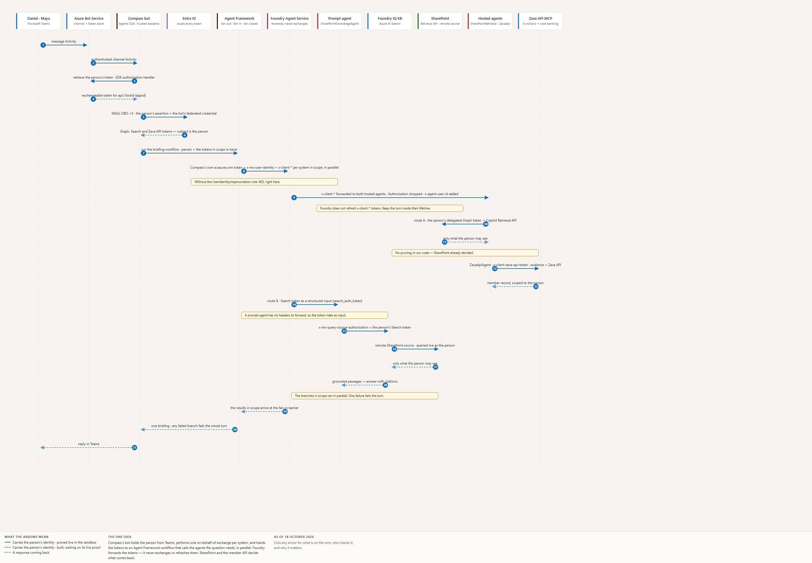
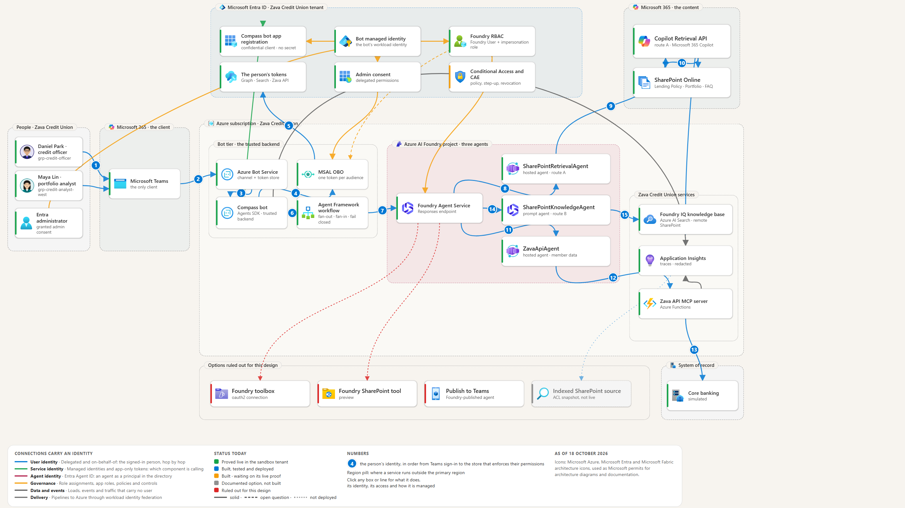

# Compass: the Teams user's own identity, from Teams to SharePoint through a Foundry hosted agent

**Note:** this is a teaching and reference document. **Zava Credit Union** and its **Compass** Teams assistant are fictional,
and every person named is a fictional persona. The Microsoft Learn citations, technical findings and recommended pattern are real.

**For:** engineers and architects building an assistant whose answers must respect each person's own permissions.
**Status:** draft for review, 4 October 2026. Every statement about Microsoft behaviour cites the Learn page it comes from,
read on 4 October 2026. *(preview)* marks preview features. **[Inference]** marks our reasoning where Learn is silent.
**Reference build:** `Zava-Compass-OBO-DevSpec.md` (this folder) is a .NET 10/C# development spec that implements the
recommended pattern below end-to-end — Teams bot, one hosted agent for §5.1 (Copilot Retrieval API), one hosted
agent for the Zava Credit Union API/MCP path — and documents, rather than builds, the other SharePoint retrieval options in §5.

---

## 1. The short answer

**Can a Foundry hosted agent, used from Teams (and later Microsoft 365 Copilot), read SharePoint as the signed-in
person, so that their own SharePoint permissions decide what comes back? Yes, on one documented route, with no
post-retrieval pruning.**

| Question | Answer | Confidence |
| --- | --- | --- |
| Is there a documented end-to-end route? | **Yes.** A trusted backend that already holds the person's token performs on-behalf-of (OBO) itself and calls the hosted agent with its own token, the person's object ID, and the person's downstream tokens in `x-client-*` headers. Learn calls this "application-managed OBO and token forwarding, not a token exchange performed by Foundry" ([OBO with hosted agents][l-hosted-obo]) | High |
| Can Compass's bot be that backend? | **Yes [Inference].** A Microsoft 365 Agents SDK bot authenticates the Teams user and is a confidential client that can do OBO. Learn's OBO page doesn't name the Agents SDK, and there's no published sample of this exact pairing | High |
| Is the "midstream" token exchange already possible? | **Yes, inside the bot, with Entra.** In the exchangeable-token configuration, Bot Service brokers and stores the person's token for the bot's own API; the bot then obtains each downstream token by MSAL OBO, and **Entra** issues them ([Agents SDK OAuth][l-sdk-oauth]) | High |
| Can SharePoint's own permissions decide, live? | **Yes:** the Microsoft 365 Copilot Retrieval API called with the person's delegated Graph token; or a Foundry IQ remote SharePoint knowledge source *(preview)* with the person's Search token | High (Retrieval API); medium (remote knowledge source) |
| Does Foundry's own "Publish to Teams" do this? | **Not established for Zava Credit Union's no-new-prompt requirement.** The SharePoint tool "doesn't work when the agent is published to Microsoft Teams" ([SharePoint tool][l-sp-tool]); other pages describe delegation without documenting the full silent Teams-to-tool token path | High |
| Can the toolbox reuse Compass's existing Teams token? | **Not on any documented path.** A toolbox `oauth2` connection runs Foundry's own per-person authorization flow when no grant exists, and Learn documents no way to hand it an existing token. `user-entra-token` connections are a different, platform-managed mechanism, documented for Microsoft services ([tool authentication][l-tool-auth]) | High |

**What we haven't proven ourselves yet:** the Teams bot as the backend, and SharePoint as the store. We've proven the
same forwarding pattern in our own reference build (section 7) with a web front end, Azure AI Search and Fabric. A short
spike on Zava Credit Union's tenant closes it (section 9).

---

## 2. The scenario

The requirements behind this document, as a fictional team's situation:

- **Teams is Compass's only client today.** No Copilot or Copilot Studio client yet.
- **Compass's own code already does OBO.** Its function tools, and the Azure Functions behind them, act as the person.
- **The toolbox prompts again.** A toolbox connection to an MCP server put a separate sign-in and consent in front of each
  server, although Compass already had the person from Teams. Silent on-behalf-of was not available through it.
- **MCP direction.** The team wants its function tools as reusable MCP servers (Azure Functions already work well as MCP),
  and expects to keep calling MCP servers from Compass's own code so that it can pass headers explicitly.
- **Hosted agents** look best for simpler, non-orchestrator agents first; the full assistant stays custom for now.
- **The ask:** a way to exchange a token midstream through Entra, rather than operating a token-exchange service of its own.
- **SharePoint today (assumed, not confirmed):** documents are retrieved with a shared identity and pruned in function-tool
  code by the person's identity and access. Confirm this before relying on it.

---

## 3. Why the toolbox prompts, and why the token service isn't the blocker

### 3.1 The toolbox

A toolbox `oauth2` connection is an **authorization-code grant run by Foundry**: "With `oauth2`, the user completes an
OAuth authorization flow, and Foundry stores and refreshes the resulting credentials", and "Foundry generates a consent
link the first time a particular user needs to authorize a tool" ([tool authentication][l-tool-auth]). "The scope of OAuth
is per tool (connection) name per Foundry project" ([MCP authentication][l-mcp-auth]).

A hosted agent's code never receives the caller's `Authorization` header ("The gateway never forwards credential headers
such as `Authorization`", [hosted agent contract][l-contract]), and we found no documented way to supply an existing
Teams or OBO token to a toolbox `oauth2` connection through `x-client-*`. So the first call per person per connection asks
for authorization. After that it can be silent while the stored grant remains valid (the connection must request
`offline_access` so Foundry can refresh it), until it expires or is revoked; tenant policy such as Conditional Access can
still require interaction.

`user-entra-token` connections are a different, platform-managed delegation mechanism ("Foundry handles token acquisition,
exchange, refresh, and injection"), documented for "Managed Microsoft services that require an audience-specific Entra
token"; support for a customer's own API, and where the token comes from in a Teams-published agent, need confirming
([tool authentication][l-tool-auth]). In our reference build,
a Microsoft-audience token was refused for a non-Microsoft MCP endpoint ("Cannot pass Microsoft token to untrusted MCP
endpoint").

**So:** for integrations that must reuse Compass's existing user assertion without another Foundry authorization flow,
bypass toolbox `oauth2`: call the MCP server or API from the hosted agent's code with a token the bot obtained by OBO.
That's what the engineering team proposed. Toolboxes remain fine for tools that don't act as a person, and for per-person integrations
whose one-time consent model is acceptable.

### 3.2 The Bot Framework token service

The Agents SDK's user authorization works like this in the configuration we recommend ([Agents SDK OAuth][l-sdk-oauth],
[Teams SSO setup][l-sdk-sso]):
1. **Bot Service brokers and stores the first token.** The OAuth connection is configured for the bot's own API
   (`api://botid-{appid}/defaultScopes`): "Azure Bot Service manages the token exchange, and the agent retrieves the
   resulting user token during a turn." A normal message Activity doesn't carry it; the bot retrieves it through the
   SDK's authorization handler.
2. **Downstream tokens come from Entra.** OBO "relies on the initial user sign-in returning an exchangeable token". The
   bot exchanges it with MSAL as a confidential client (`OBOConnectionName` and `OBOScopes`, or `ExchangeTurnTokenAsync`),
   and **Entra** issues the downstream tokens, not token.botframework.com. (A token for Graph can't be used as the OBO
   assertion; it must be for the bot's API.)

Other OAuth configurations have Bot Service return a downstream token directly with no OBO; this pattern deliberately
doesn't. So Compass can already exchange a token midstream, with Entra, inside the bot. It can be silent when consent is
already granted and tenant policies are satisfied; Conditional Access, MFA or continuous access evaluation may still
require the person to interact. The question for the Agents SDK team is narrower than "when will you move to Entra"
(section 10).

---

## 4. The recommended pattern

*The flow in time. Interactive version: `diagrams/Zava-Compass-OBO-Sequence.html` - click any arrow for
what is on the wire, who checks it, and why it matters.*

And the same design as structure, with every boundary and both ruled-out options:

*Level 3. Each line is coloured by whose identity it travels as; the numbered circles follow the
person from Teams sign-in (1) to the store that enforces their permissions. Interactive version:
`diagrams/Zava-Compass-OBO-Architecture.html` - three C4 levels and five walkthroughs.*

| # | Caller → callee | Credential on the wire | Obtained by | Checked by |
| --- | --- | --- | --- | --- |
| 1 | Teams → Bot Service → Compass bot | The person's token for the bot's API (`api://botid-{appid}`), retrieved from the Bot Service token store | Teams SSO; Bot Service | Bot Service, then the bot |
| 2 | Compass bot → Entra | The person's token as the OBO assertion; the bot's client credential (a federated identity credential on the bot's **app registration**, trusting the bot's managed identity: no secret) | MSAL, confidential client | Entra (consent, Conditional Access) |
| 3 | Compass bot → Foundry (the hosted agent's Responses endpoint) | **Compass's own** token for `https://ai.azure.com`; `x-ms-user-identity` = the person's object ID (not a token); `x-client-graph-access-token`, `x-client-search-token`, `x-client-zava-api-token` = the person's OBO tokens | The bot | Foundry RBAC: **Foundry Agent Consumer** plus a custom role holding `…/agents/endpoints/UserIdentityImpersonation/action`, both scoped to that one agent ([OBO with hosted agents][l-hosted-obo], [hosted agent permissions][l-hosted-perms]) |
| 4 | Foundry → container | `x-client-*` headers forwarded; `Authorization` dropped; `x-agent-user-id` added | The platform | — |
| 5 | Hosted agent → SharePoint, Search or a Zava Credit Union MCP server | The person's token for that API, from its `x-client-*` header | Already obtained at hop 2 | **The store or API**, as the person |
| 6 | Zava Credit Union MCP server (Functions) → Workday, core systems | That system's own verified user-delegation mechanism: Entra OBO only where the system supports it; otherwise document how the employee's identity is preserved (unconfirmed for Workday today) | The Function | That system |

Learn's requirements, quoted ([OBO with hosted agents][l-hosted-obo]):
- "A trusted application backend that authenticates users and can perform OBO as a confidential client."
- The impersonation data action "isn't included in built-in roles"; without it, sending `x-ms-user-identity` is refused
  with 403 ([hosted agent permissions][l-hosted-perms]).
- Foundry "forwards the `x-client-*` header to the container, but not the caller's Authorization header", and "doesn't
  exchange or refresh the token in `x-client-*`".
- "End users don't need Foundry role assignments in this pattern."
- "Never switch silently to app-only access."

**Deployment prerequisites** ([OBO with hosted agents][l-hosted-obo]):
- Deploy the hosted agent with **container protocol 2.0.0** and the Responses protocol; call
  `POST https://<account>.services.ai.azure.com/api/projects/<project>/agents/<agent>/endpoint/protocols/openai/responses?api-version=v1`.
- The bot's workload token is for `https://ai.azure.com/.default`.
- Grant the bot's workload identity **Foundry Agent Consumer** and a custom role containing
  `Microsoft.CognitiveServices/accounts/AIServices/agents/endpoints/UserIdentityImpersonation/action`, both scoped to the
  agents it must call.
- Forward each downstream access token in its application-defined `x-client-*` header, without a `Bearer` prefix.
- For secretless OBO, put a federated identity credential on the bot's app registration trusting the bot's managed
  identity ([app trusts managed identity][l-mi-fic]); Bot Service's OAuth connection credential is configured separately.
- Teams SSO also needs the Teams desktop, mobile and web client IDs pre-authorized, the Token Exchange URL on the OAuth
  connection, and `webApplicationInfo` in the manifest ([Teams SSO setup][l-sdk-sso]).

**Why this also fixes MCP.** Zava Credit Union's Functions-based MCP servers keep doing what they do today: validate a token issued
for their own API, then use each downstream system's verified delegation mechanism (Entra OBO where supported). The hosted agent's code calls them with the person's token for that API (from
`x-client-zava-api-token`). That follows the MCP specification's rule that a server never passes the token it received
through to a different API.

**Surfaces.** Teams works today with the Agents SDK. The same bot is offered in Microsoft 365 Copilot as a custom
engine agent (observed working on 18 Oct once the manifest declared it); check its licensing and manifest requirements. Because the bot owns the conversation,
it isn't bound by the published-agent limits ("Published agents don't support streaming responses or citations",
[publish][l-publish-vnet]).

**The C# blocker.** This pattern doesn't need the hosted-agent Activity package: the bot speaks Activity to Teams, and
calls the hosted agent over Responses. For the hosted agent itself, Learn documents C# adapters for the Responses and
Invocations protocols (`Azure.AI.AgentServer.Responses`, `Azure.AI.AgentServer.Invocations`) ([hosted agent
contract][l-contract]).

---

## 5. SharePoint: six ways to retrieve, and how OBO works in each

Baseline for every option: hops 1 to 4 above. Only the retrieval hops are shown.

### 5.1 Microsoft 365 Copilot Retrieval API, called directly (recommended)

The hosted agent calls `POST https://graph.microsoft.com/v1.0/copilot/retrieval` with the person's delegated Graph token
(Files.Read.All, Sites.Read.All). SharePoint's permissions and labels decide, through Microsoft 365's own index. Learn's hosted-agent OBO sample
demonstrates the transport: forwarding `x-client-graph-access-token` and calling Graph `/me` ([OBO with hosted
agents][l-hosted-obo]). Applying it to the Retrieval API needs delegated `Files.Read.All` and `Sites.Read.All`
([Retrieval API][l-retrieval]). The Agents SDK's `retrieval-agent` sample: "It uses the signed-in user's delegated Microsoft
Graph token, so every result respects that user's SharePoint permissions" ([sample][l-sample-retrieval]).

| Hop | Caller → callee | Credential | Obtained by | Enforced by |
| --- | --- | --- | --- | --- |
| R1 | Hosted agent → Graph `copilot/retrieval` | The person's Graph token | The bot (OBO) | **SharePoint permissions, via Microsoft 365's index** |

- Licensing: each calling person needs a Microsoft 365 Copilot add-on licence ("available at no extra cost to users with
  a Microsoft 365 Copilot add-on license") or Retrieval API pay-as-you-go *(preview)*. Pay-as-you-go requires "At least
  one Microsoft 365 Copilot license in the tenant before enablement and during use", admin enablement and Azure billing;
  it covers SharePoint and Copilot connectors, not OneDrive ([pay-as-you-go][l-paygo]).
- Limits: 200 requests per person per hour, 25 results, 1,500-character queries; malformed KQL is ignored; results are
  unordered. Content freshness depends on Microsoft 365's indexing; verify permission-change and revocation behaviour rather than
  assuming instantaneous propagation.
- Governance: snippets flow into Foundry and the model; check retention and regional approval. Available in the global
  commercial cloud; review the Microsoft 365 Copilot APIs terms of use ([terms][l-m365-api-terms]).

### 5.2 Foundry IQ knowledge base with a remote SharePoint knowledge source *(preview)*

The knowledge base queries SharePoint live through the Retrieval API: "the retrieval engine queries SharePoint on behalf
of the user", and "SharePoint permissions and Microsoft Purview sensitivity labels are honored". The person's token is
for `https://search.azure.com`, in `x-ms-query-source-authorization` ([remote SharePoint][l-ks-remote],
[retrieve][l-kb-retrieve]).

| Hop | Caller → callee | Credential | Obtained by | Enforced by |
| --- | --- | --- | --- | --- |
| R1 | Hosted agent → knowledge base `retrieve` (or its MCP endpoint) | The agent identity (Search Index Data Reader) in `Authorization`; the person's Search token in `x-ms-query-source-authorization` | The bot (OBO), forwarded as `x-client-search-token` | — |
| R2 | Azure AI Search → Retrieval API | "Passes the token": **how** Search turns it into a Graph call isn't documented | Azure AI Search | **SharePoint permissions and labels** |

Use it when Compass wants one retrieval call across several knowledge sources. Same licensing and limits as 5.1. Learn's
samples use prompt agents; there's no hosted-agent sample **[Inference: works the same way]**.

### 5.3 Foundry IQ knowledge base with an indexed SharePoint knowledge source *(preview)*

An indexer copies SharePoint content into an index. Create the knowledge source with the required
`ingestionPermissionOptions` so permission metadata is ingested; the person's Search token is then checked against those
ACLs at query time ([indexed SharePoint][l-ks-indexed]).

| Hop | Caller → callee | Credential | Obtained by | Enforced by |
| --- | --- | --- | --- | --- |
| Ingest | Indexer → SharePoint | **App-only** ("ACL ingestion requires application permissions") | Azure AI Search | — (a snapshot of ACLs) |
| R1 | Hosted agent → knowledge base | Agent identity + the person's Search token | The bot (OBO) | **Azure AI Search**, against ingested ACLs |

Watch out ([retrieve][l-kb-retrieve]): "For indexed sources, the retrieval engine … returns unfiltered results if it's
omitted" (the person's token), and without `ingestionPermissionOptions` "The system returns results unfiltered,
regardless of the header". So **your code must refuse to call without the token**. ACL changes appear after re-sync. Some SharePoint sharing models aren't
supported ("Anyone" links, guests, Entra groups nested in SharePoint groups) ([SharePoint ACLs][l-sp-acl]).

### 5.4 Azure AI Search index over SharePoint, trimmed at query time

An option if Compass's current SharePoint-backed index and pruning design is confirmed. Two ways to trim at query time
instead of after retrieval:
- **ACL ingestion + the person's token** *(preview)*: as 5.3, against a classic index. "Document visibility requires
  both: The calling application's RBAC role (Authorization header). The user identity carried by
  x-ms-query-source-authorization" ([query-time ACLs][l-search-acl]). On this classic `docs/search` path, an omitted
  token returns only public documents (unlike the knowledge base's indexed sources in 5.3).
- **Security filters (GA):** your code resolves the person's groups (Graph, with their OBO token) and adds a filter on a
  permissions field you maintain. "There's no authentication or authorization through the security principal. The
  principal is just a string" ([security filters][l-sec-filters]), so correctness is your code's.

| Hop | Caller → callee | Credential | Obtained by | Enforced by |
| --- | --- | --- | --- | --- |
| R1 | Hosted agent → Search `docs/search` | Agent identity + the person's Search token (ACLs), **or** agent identity + a filter built from the person's groups | The bot (OBO) | Search (ACLs), or **Zava Credit Union code** (filters) |

**Why move off post-retrieval pruning.** Pruning after a top-k search can return too few results when most hits are
pruned, sends unauthorized content through more of your code than necessary, and puts the correctness of SharePoint's
permission model on your code. Trimming at query time (filters or ACLs) fixes the first two; letting SharePoint's own
permissions decide (5.1, 5.2) fixes all three.

### 5.5 The Foundry SharePoint tool *(preview)* — not for this design

It requires the person's own identity ("App-only and service-principal authentication aren't supported"), isn't available
in a toolbox, "doesn't work when the agent is published to Microsoft Teams", and needs every person to hold Foundry User
([SharePoint tool][l-sp-tool], [toolbox overview][l-toolbox]). From a hosted agent it would mean the bot getting each
person's `https://ai.azure.com` token and invoking a prompt agent as them: possible, undocumented, and a wide Foundry
grant. 5.1 gives the same result directly.

### 5.6 A Foundry IQ knowledge base attached as an MCP tool

For a **prompt agent**, the caller passes the person's Search token through `structured_inputs` into the
`x-ms-query-source-authorization` header, and Learn says to "use a token obtained through an on-behalf-of flow"
([Foundry IQ connect][l-fiq-connect]). For a **hosted agent**, the toolbox has no documented way to inject a per-request
token, but hosted code can call the knowledge base's MCP or retrieve endpoint directly with the forwarded token (5.2 or
5.3); each knowledge base exposes an MCP endpoint "for consumption by MCP-compatible agents" ([retrieve][l-kb-retrieve]).

### 5.7 Comparison

| Option | The person's identity reaches SharePoint | Silent | Live permissions | GA / preview | Recommendation |
| --- | --- | --- | --- | --- | --- |
| 5.1 Retrieval API | Yes (delegated Graph) | Yes, subject to consent and policy | **Yes** (via Microsoft 365's index) | Graph v1.0; pay-as-you-go preview | **Primary** |
| 5.2 Remote SharePoint knowledge source | Yes (through Search) | Yes, subject to consent and policy | **Yes** | Preview | When multi-source retrieval is wanted |
| 5.3 Indexed SharePoint knowledge source | No: Search checks ingested ACLs | Yes | No (re-sync lag) | Preview | Only for content the Retrieval API can't serve |
| 5.4 Search index + ACLs or filters | No: Search or your code checks | Yes | No | ACLs preview; filters GA | Potential interim step, if Zava Credit Union confirms today's post-retrieval pruning design |
| 5.5 SharePoint tool | Yes | Needs per-person Foundry token | Yes | Preview | Not for hosted agents in Teams |
| 5.6 Knowledge base via MCP | Through the user token on the request | Yes, subject to consent and policy | Depends on source | Preview | Prompt-agent binding documented; hosted code can call the MCP endpoint directly; no documented toolbox per-request token injection |

---

## 6. The Compass identity contract (a reusable standard)

For every agent Zava Credit Union builds on this pattern:
1. **The person is resolved once, by the bot**, from the Teams SSO token. No model, prompt or tool argument ever carries
   who the caller is.
2. **One OBO per downstream API, per turn**, in the bot. Each token goes to exactly one approved destination, with no
   credential-bearing redirects, is never logged, is redacted from proxies and telemetry, and isn't kept past the request.
   (Request-only retention is our proposed policy; MSAL itself supports token caching.)
3. **The bot is the only identity that may assert a person** to the hosted agent (`x-ms-user-identity`), and only to the
   agents it must call (the impersonation role at agent scope).
4. **The store decides.** Retrieve with the person's token, or trim at query time; don't prune after retrieval.
5. **Fail closed.** No person's token, no call; never fall back to app-only. Carry a claims challenge back to the bot so
   the person can satisfy it through Teams sign-in.
6. **No agent calls another on a person's behalf** unless that path is designed and proven on its own. (In our reference
   build, a nested agent served one person's stored consent to the next.)
7. **Prove it with two people, in both orders**, with the store reporting who it read, and again after any change to the
   path.
8. **Keep per-person state apart.** "Within delegation, the platform doesn't fence one delegated end user from another"
   ([session isolation][l-isolate]). Give each person their own session ID from the bot; never accept client-supplied
   session, conversation or response IDs; partition files, rows and caches by session ID and `x-agent-user-id`; and test
   cross-user continuation. Learn's multiplexing page states a response chain "can't be continued by another user"
   ([multiplexing][l-multiplex]); confirm with Foundry before pooling sessions.

---

## 7. What we've proven in our reference build

Our reference build (a credit-memo agent on Foundry, built for a financial-services workshop) uses the same pattern with
a web front end in place of the Teams bot:
- A backend with no secret (a federated credential on its app registration, trusting its managed identity) obtains each person's Search token by OBO and
  forwards it to a hosted agent in an `x-client-*` header; document permissions in Azure AI Search were enforced per
  person, and no JWT-shaped string was found in the sampled traces.
- The same backend obtains each person's Foundry token by OBO and invokes a Fabric-reading agent as that person; Fabric
  reported the right person in both orders.
- A toolbox `oauth2` connection asked each person to consent once; a nested agent with a user-delegated tool served one
  person's stored consent to another, which is why rule 6 exists.

Not yet proven by us: a Teams bot as the backend, and SharePoint as the store.

---

## 8. Constraints to plan for

- **Token lifetime.** Foundry doesn't refresh `x-client-*` tokens. Obtain them per turn; keep a turn's work inside the
  token's lifetime.
- **Consent and policy.** Admin-consent the bot's downstream delegated permissions (Graph `Files.Read.All` and
  `Sites.Read.All`, Azure AI Search, Zava Credit Union's API). Conditional Access, MFA or continuous access evaluation can still
  require interaction; surface those errors to the bot.
- **Licensing.** The Retrieval API (5.1, 5.2) needs a Microsoft 365 Copilot licence per calling person or pay-as-you-go
  *(preview)*, which needs at least one Copilot licence in the tenant.
- **Header size.** Learn gives no numeric limit for forwarded headers; test with realistic tokens.
- **The bot is a trust boundary.** It can assert any person to the agents its role covers. Scope the role to those
  agents, take the object ID only from a validated token, and give the bot no secret.
- **Preview.** Remote and indexed SharePoint knowledge sources, ACL ingestion, the SharePoint indexer and pay-as-you-go
  are preview.

---

## 9. A spike to close the gap (about a day)

1. A minimal Agents SDK bot (C#) in Teams with SSO and `OBOConnectionName` for Graph and Zava Credit Union's API; admin consent.
2. A minimal hosted agent that reads `x-client-graph-access-token`, calls the Retrieval API, and returns the hits with
   their site URLs; and calls one Zava Credit Union Functions MCP tool with `x-client-zava-api-token`.
3. The bot's managed identity: Foundry Agent Consumer + the impersonation custom role on that agent.
4. Two test users with different SharePoint access. Run user A then B, and B then A. Pass: each sees only their own
   documents, the Function's logs show each person, and no token appears in traces or logs.
5. Negative tests: missing token → no downstream call; expired or invalid token → failure returned to the bot, which
   gets a fresh token; a real Conditional Access or CAE claims challenge → carried back and satisfied through Teams
   sign-in.

---

## 10. Questions for the product teams

**For the engineering lead's call with the Microsoft 365 Agents SDK team** — sharper than "when will you move off your own STS":
1. Is there a roadmap for Teams SSO and user sign-in **without the Bot Framework token service** (Entra-native), for
   example through the Entra Agent ID sidecar, which today covers only outbound channel tokens?
2. Can you publish a sample of an **Agents SDK bot calling a Foundry hosted agent** with `x-ms-user-identity` and
   `x-client-*` (the documented hosted-agent OBO pattern)?
3. For Agent 365's OBO mode ("the user is the token subject and the agent identity is the actor"), can a custom engine
   agent use it without Frontier?
4. When will the C# hosted-agent Activity package ship, and when is multitenant federated-credential OAuth expected?

**For Foundry Agent Service:**
1. The hosted-agents page says that through Microsoft 365 channels, "If a user token is present, the platform supports
   OAuth 2.0 On-Behalf-Of (OBO) flows." In a Foundry-published Teams agent, where does that token come from, and how do
   code or toolbox connections use it?
2. Will the toolbox accept a per-request user token (from `x-client-*`, or header templating like `structured_inputs`),
   so `oauth2`-style connections can be silent?
3. Can `user-entra-token` target a customer API audience?
4. Will the SharePoint tool work in Teams-published agents or in toolboxes?
5. Learn's agent identity page says "Agent Service then exchanges that token"; the OBO page says "not a token exchange
   performed by Foundry". Which applies to which tools?

**For Azure AI Search:**
1. In a remote SharePoint knowledge source, how does Search turn the person's Search token into a Retrieval API call
   (which app, what consent, which Conditional Access applies, what's audited)?
2. Can indexed sources be set to **fail closed** when `x-ms-query-source-authorization` is missing?
3. GA timing for the SharePoint indexer, ACL ingestion and remote SharePoint knowledge sources?

---

## Sources

- [Use on-behalf-of flow with hosted agents][l-hosted-obo]
- [Hosted agent permissions][l-hosted-perms]
- [Hosted agent contract][l-contract]
- [Hosted agents concepts][l-hosted]
- [Isolate sessions per user][l-isolate]
- [Toolbox authentication][l-tool-auth]
- [MCP server authentication][l-mcp-auth]
- [Toolbox overview][l-toolbox]
- [Publish agents to Microsoft 365 Copilot and Teams][l-publish]
- [Publish agents with a virtual network][l-publish-vnet]
- [SharePoint tool][l-sp-tool]
- [Foundry IQ: connect a knowledge base][l-fiq-connect]
- [Retrieve from a knowledge base (permissions)][l-kb-retrieve]
- [Remote SharePoint knowledge source][l-ks-remote]
- [Indexed SharePoint knowledge source][l-ks-indexed]
- [SharePoint indexer ACLs][l-sp-acl]
- [Query-time ACL and RBAC enforcement][l-search-acl]
- [Security filters in Azure AI Search][l-sec-filters]
- [Microsoft 365 Copilot Retrieval API][l-retrieval]
- [Microsoft 365 Agents SDK: OAuth configuration][l-sdk-oauth]
- [Microsoft 365 Agents SDK: user authorization with federated credentials][l-sdk-sso]
- [Agents SDK sample: retrieval-agent][l-sample-retrieval]
- [Retrieval API pay-as-you-go][l-paygo]
- [Microsoft 365 Copilot APIs terms of use][l-m365-api-terms]
- [Multiplex session users][l-multiplex]
- [Configure an app to trust a managed identity][l-mi-fic]
- [Microsoft Entra Agent ID: OBO flow][l-agent-obo]
- [Microsoft Agent 365: identity][l-a365-identity]

[l-hosted-obo]: https://learn.microsoft.com/en-us/azure/foundry/agents/how-to/use-on-behalf-of-flow
[l-hosted-perms]: https://learn.microsoft.com/en-us/azure/foundry/agents/concepts/hosted-agent-permissions
[l-contract]: https://learn.microsoft.com/en-us/azure/foundry/agents/concepts/hosted-agent-contract
[l-hosted]: https://learn.microsoft.com/en-us/azure/foundry/agents/concepts/hosted-agents
[l-isolate]: https://learn.microsoft.com/en-us/azure/foundry/agents/how-to/isolate-sessions-per-user
[l-tool-auth]: https://learn.microsoft.com/en-us/azure/foundry/agents/how-to/tools/tool-authentication
[l-mcp-auth]: https://learn.microsoft.com/en-us/azure/foundry/agents/how-to/mcp-authentication
[l-toolbox]: https://learn.microsoft.com/en-us/azure/foundry/agents/concepts/toolbox-overview
[l-publish]: https://learn.microsoft.com/en-us/azure/foundry/agents/how-to/publish-copilot
[l-publish-vnet]: https://learn.microsoft.com/en-us/azure/foundry/agents/how-to/publish-copilot-virtual-network
[l-sp-tool]: https://learn.microsoft.com/en-us/azure/foundry/agents/how-to/tools/sharepoint
[l-fiq-connect]: https://learn.microsoft.com/en-us/azure/foundry/agents/how-to/foundry-iq-connect
[l-kb-retrieve]: https://learn.microsoft.com/en-us/azure/search/agentic-retrieval-how-to-retrieve
[l-ks-remote]: https://learn.microsoft.com/en-us/azure/search/agentic-knowledge-source-how-to-sharepoint-remote
[l-ks-indexed]: https://learn.microsoft.com/en-us/azure/search/agentic-knowledge-source-how-to-sharepoint-indexed
[l-sp-acl]: https://learn.microsoft.com/en-us/azure/search/search-indexer-sharepoint-access-control-lists
[l-search-acl]: https://learn.microsoft.com/en-us/azure/search/search-query-access-control-rbac-enforcement
[l-sec-filters]: https://learn.microsoft.com/en-us/azure/search/search-security-trimming-for-azure-search
[l-retrieval]: https://learn.microsoft.com/en-us/microsoft-365/copilot/extensibility/api/ai-services/retrieval/overview
[l-sdk-oauth]: https://learn.microsoft.com/en-us/microsoft-365/agents-sdk/agent-oauth-configuration
[l-sdk-sso]: https://learn.microsoft.com/en-us/microsoft-365/agents-sdk/azure-bot-user-authorization-federated-credentials
[l-sample-retrieval]: https://github.com/microsoft/Agents/blob/main/samples/python/retrieval-agent/README.md
[l-agent-obo]: https://learn.microsoft.com/en-us/entra/agent-id/agent-on-behalf-of-oauth-flow
[l-a365-identity]: https://learn.microsoft.com/en-us/microsoft-agent-365/developer/identity
[l-paygo]: https://learn.microsoft.com/en-us/microsoft-365/copilot/extensibility/api/ai-services/retrieval/paygo-retrieval
[l-m365-api-terms]: https://learn.microsoft.com/en-us/legal/m365-copilot-apis/terms-of-use
[l-multiplex]: https://learn.microsoft.com/en-us/azure/foundry/agents/how-to/multiplex-session-users
[l-mi-fic]: https://learn.microsoft.com/en-us/entra/workload-id/workload-identity-federation-config-app-trust-managed-identity
